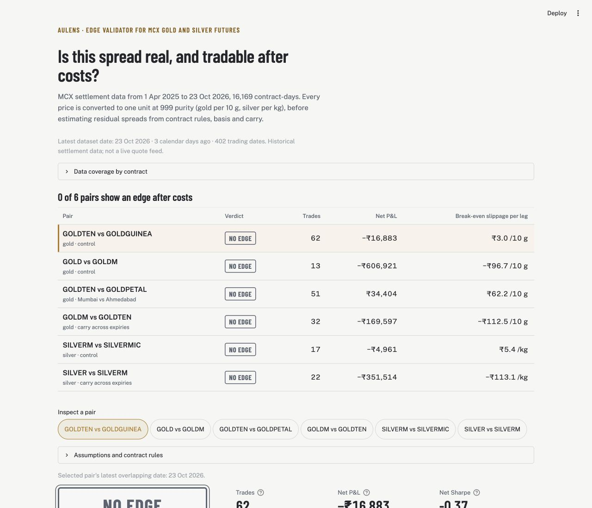

# AuLens

**Is this MCX gold spread real — and is it tradable after costs?**

AuLens is an *edge validator* for India's MCX gold futures. MCX lists the same metal in five
contract sizes (GOLD, GOLDM, GOLDTEN, GOLDGUINEA, GOLDPETAL). Their prices never line up
exactly, and most of the gap is written into the contract rules: purity (995 vs 999),
quotation unit, settlement city (Ahmedabad vs Mumbai), expiry date and tender window.

AuLens removes everything the rulebook explains, tests whether the residual survives real
costs, walk-forward and across regime breaks within the available history, and returns one honest verdict per pair:
**EDGE**, **NO EDGE** or **UNTESTABLE**.

Team **CodeWick** · Hack in Hills '26 · Track 03: Commodity Derivatives Intelligence

**Live demo:** <https://hackhill-wikhjmugah4iqupyf4nlh4.streamlit.app/> · real MCX data, 1 Apr 2025 – 23 Oct 2026



## Quick start

```bash
git clone <repo-url> aulens && cd aulens
python -m venv .venv && source .venv/bin/activate      # Windows: .venv\Scripts\activate
pip install -r requirements.txt

# 1. Build a dataset
python scripts/build_dataset.py --sample                # synthetic, to develop the UI
python scripts/build_dataset.py --raw data/raw          # real MCX data; refresh it with scripts/mcx_fetch_in_browser.js

# 2. Verdicts in the terminal
python scripts/run_backtest.py

# 3. Dashboard
streamlit run app/streamlit_app.py

# 4. Tests
pytest -q
```

## What it does

| Step | Module | What happens |
|---|---|---|
| Normalize | `aulens/normalize.py` | Every contract → ₹ per 10 g at 999 purity using MCX's own formulas |
| Pair | `aulens/normalize.py` | Gram-matched lots (e.g. 4 GOLDTEN vs 5 GOLDGUINEA = 40 g), same expiry only (GOLDM month M+1 vs GOLDTEN month M) |
| Expect | `aulens/backtest.py` | Convergence target from settlement rules (0 for the control pair) |
| Validate | `aulens/backtest.py` | Walk-forward, T+1 fills, exits before tender, volume filter |
| Cost | `aulens/costs.py` | CTT, MCX fee, SEBI fee, stamp duty, GST, brokerage, slippage |
| Decide | `aulens/verdict.py` | Net P&L, bootstrap CI, results by regime, gold beta → verdict |

## Documentation

| Doc | For |
|---|---|
| [docs/BUILD_GUIDE.md](docs/BUILD_GUIDE.md) | Step-by-step: how to build and finish the prototype |
| [docs/TEAM_TASKS.md](docs/TEAM_TASKS.md) | Who does what, day by day |
| [docs/ARCHITECTURE.md](docs/ARCHITECTURE.md) | System design and data flow |
| [docs/VALIDATION.md](docs/VALIDATION.md) | Walk-forward evidence, execution assumptions, beta and omitted costs |
| [docs/METHODOLOGY.md](docs/METHODOLOGY.md) | The maths: normalization, convergence, walk-forward, verdicts |
| [docs/DATA.md](docs/DATA.md) | Getting real MCX data, and its quirks |
| [docs/MCX_DATA_API.md](docs/MCX_DATA_API.md) | MCX endpoints, reconstructed from the site's own scripts |
| [docs/CONTRACT_SPECS.md](docs/CONTRACT_SPECS.md) | The rulebook, with what still needs verifying |
| [docs/COSTS.md](docs/COSTS.md) | Transaction-cost model and worked examples |
| [docs/LIMITATIONS.md](docs/LIMITATIONS.md) | What AuLens cannot tell you |
| [docs/QA.md](docs/QA.md) | Finale Q&A: honest answers backed by the real-data numbers |
| [docs/DEMO_SCRIPT.md](docs/DEMO_SCRIPT.md) | 2-minute demo video script |
| [docs/SUBMISSION_CHECKLIST.md](docs/SUBMISSION_CHECKLIST.md) | Before every round |

## Results (real MCX data, 1 Apr 2025 – 23 Oct 2026)

**None of the six pairs establishes an edge after modelled costs.** Default assumptions: ₹20 slippage per leg
(per 10 g for gold, per kg for silver), 50-lot minimum volume, each leg capped at 2% of its daily
volume, walk-forward `z_entry`.

| Pair | Verdict | Trades | Net P&L | Net Sharpe | 90% CI, mean trade | Break-even slippage per leg | Metal beta |
|---|---|---|---|---|---|---|---|
| GOLDTEN vs GOLDGUINEA (control) | **NO EDGE** | 62 | −₹16,883 | −0.37 | −₹1,305 to ₹845 | ₹3.0 /10 g | 0.07 |
| GOLD vs GOLDM (control) | **NO EDGE** | 12 | −₹5,93,492 | −1.28 | −₹1,14,656 to −₹1,412 | −₹103.6 /10 g | 0.03 |
| GOLDTEN vs GOLDPETAL | **NO EDGE** | 49 | ₹35,653 | 0.83 | −₹527 to ₹2,044 | ₹65.5 /10 g | 0.14 |
| GOLDM vs GOLDTEN (stretch) | **NO EDGE** | 32 | −₹1,69,597 | −1.24 | −₹12,236 to ₹404 | −₹112.5 /10 g | 0.25 |
| SILVERM vs SILVERMIC (silver control) | **NO EDGE** | 15 | −₹2,783 | −0.20 | −₹1,492 to ₹1,489 | ₹10.7 /kg | −0.01 |
| SILVER vs SILVERM (silver carry) | **NO EDGE** | 20 | −₹3,41,647 | −1.75 | −₹33,491 to −₹5,818 | −₹122.4 /kg | 0.04 |

- **Control pairs:** both gold controls settle on the same price at expiry (GOLDTEN/GUINEA within
  ±₹1 on all 18 expiries, GOLD/GOLDM exactly ₹0 on 9), and SILVERM/SILVERMIC settles at exactly
  ₹0 on all 8 expired contracts. That validates the normalization. But the gap only closes inside the
  tender window, after the backtest must exit, so none of them can be traded.
- **GOLDTEN vs GOLDPETAL:** net positive, but the profit comes from one regime (22 Sep 2025 –
  1 Apr 2026), 57% of it from a single trade closed on 30 Jan 2026, and it loses after 13 May
  2026, so it fails the every-regime test.
- **GOLDM vs GOLDTEN and SILVER vs SILVERM:** the carry pairs take their worst losses on
  30 Jan 2026, when the near and far expiries moved by very different amounts. Three GOLDM vs
  GOLDTEN trades closed that day for 74% of that pair's loss, and one SILVER vs SILVERM trade for 49% of its loss. See [docs/LIMITATIONS.md](docs/LIMITATIONS.md).

Exact output of `python scripts/run_backtest.py`:

```
Data source: MCX

== GOLDTEN vs GOLDGUINEA  [NO EDGE]  4 x GOLDTEN  vs  5 x GOLDGUINEA  (40 g)
   Does not survive costs, slippage and regime splits with confidence.
   trades 62  gross ₹20,875  costs ₹17,918  slippage ₹19,840  net ₹-16,883  hit 42%
   break-even slippage ₹3.0/10 g/leg   gold beta 0.067
   net Sharpe -0.37   90% CI of mean trade ₹-1,305 to ₹845
                  count           sum
regime                               
From 01 Apr 2025      4   -343.373494
From 22 Sep 2025     30 -10825.918032
From 01 Apr 2026      2  -1932.232955
From 13 May 2026     26  -3781.245302 

== GOLD vs GOLDM  [NO EDGE]  1 x GOLD  vs  10 x GOLDM  (1 kg)
   Does not survive costs, slippage and regime splits with confidence.
   trades 12  gross ₹-438,556  costs ₹58,936  slippage ₹96,000  net ₹-593,492  hit 17%
   break-even slippage ₹-103.6/10 g/leg   gold beta 0.030
   net Sharpe -1.28   90% CI of mean trade ₹-114,656 to ₹-1,412
                  count            sum
regime                                
From 01 Apr 2025      2  -26375.131456
From 22 Sep 2025      5 -513428.531566
From 01 Apr 2026      1  -42804.239231
From 13 May 2026      4  -10884.031706 

== GOLDTEN vs GOLDPETAL  [NO EDGE]  4 x GOLDTEN  vs  40 x GOLDPETAL  (40 g)
   Does not survive costs, slippage and regime splits with confidence.
   trades 49  gross ₹65,556  costs ₹14,223  slippage ₹15,680  net ₹35,653  hit 41%
   break-even slippage ₹65.5/10 g/leg   gold beta 0.135
   net Sharpe 0.83   90% CI of mean trade ₹-527 to ₹2,044
                  count           sum
regime                               
From 01 Apr 2025      4   2671.647840
From 22 Sep 2025     27  33195.824266
From 01 Apr 2026      3    247.194325
From 13 May 2026     15   -462.137796 

== GOLDM vs GOLDTEN  [NO EDGE]  1 x GOLDM  vs  10 x GOLDTEN  (100 g)
   Does not survive costs, slippage and regime splits with confidence.
   trades 32  gross ₹-125,825  costs ₹18,172  slippage ₹25,600  net ₹-169,597  hit 34%
   break-even slippage ₹-112.5/10 g/leg   gold beta 0.249
   net Sharpe -1.24   90% CI of mean trade ₹-12,236 to ₹404
                  count            sum
regime                                
From 01 Apr 2025      5   -2119.383105
From 22 Sep 2025     18 -151123.302862
From 01 Apr 2026      2   -6371.217480
From 13 May 2026      7   -9983.303016 

== SILVERM vs SILVERMIC  [NO EDGE]  1 x SILVERM  vs  5 x SILVERMIC  (5 kg)
   Does not survive costs, slippage and regime splits with confidence.
   trades 15  gross ₹10,520  costs ₹7,303  slippage ₹6,000  net ₹-2,783  hit 13%
   break-even slippage ₹10.7/kg/leg   silver beta -0.005
   net Sharpe -0.20   90% CI of mean trade ₹-1,492 to ₹1,489
                  count          sum
regime                              
From 01 Apr 2025      1  -645.024036
From 22 Sep 2025     11 -1244.239259
From 13 May 2026      3  -894.206732 

== SILVER vs SILVERM  [NO EDGE]  1 x SILVER  vs  6 x SILVERM  (30 kg)
   Does not survive costs, slippage and regime splits with confidence.
   trades 20  gross ₹-252,270  costs ₹41,377  slippage ₹48,000  net ₹-341,647  hit 25%
   break-even slippage ₹-122.4/kg/leg   silver beta 0.042
   net Sharpe -1.75   90% CI of mean trade ₹-33,491 to ₹-5,818
                  count            sum
regime                                
From 01 Apr 2025      4   -2186.217673
From 22 Sep 2025     10 -277826.172908
From 01 Apr 2026      1  -22121.304229
From 13 May 2026      5  -39513.314862
```

## Status

- [x] Contract rulebook, normalizer, gram matching
- [x] Cost engine (configurable)
- [x] Walk-forward backtest with T+1 fills, tender exits, volume filter
- [x] Verdicts with bootstrap CI, regime split and gold beta
- [x] Streamlit dashboard, tests, synthetic data generator
- [x] Real MCX history loaded (402 trading days, 16,169 contract-days, gold and silver; see [docs/DATA.md](docs/DATA.md))
- [x] Expiry-day closes replaced by MCX's published final settlement prices (DDR)
- [x] Control-pair convergence verified on real data (`tests/test_real_data.py`)
- [x] Contract calendar, chart captions, cached sensitivity (page loads in < 5 s)
- [x] GOLDM vs GOLDTEN pair, carry-adjusted for the 5th vs month-end expiry gap
- [x] Liquidity capacity caps (1–5% of each leg's daily volume), net Sharpe, confidence interval on the verdict
- [x] Carry panel (GOLDTEN curve vs RBI repo) and quiet alerts (only for EDGE pairs that clear the hurdle)
- [x] Contract specs verified against the current MCX PDFs (GOLD/GOLDM tender window corrected to 3 days)
- [x] GOLD vs GOLDM second control, robustness grid, downloadable report
- [x] Silver family: SILVERM vs SILVERMIC control, SILVER vs SILVERM carry pair (₹/kg display)
- [x] Six-pair scoreboard on the first screen; phone-friendly pair picker and assumptions panel
- [x] Check a gap: type two quoted prices, see the rulebook-adjusted gap against the cost hurdle
- [x] Term structure: daily roll-down vs curve-change split of the GOLDTEN premium
- [x] Contract lifecycle: liquidity by days to expiry, every entry and exit drawn on the contract calendar
- [ ] GOLDM 3-day-average DDR modelled in the GOLDM vs GOLDTEN expected spread
- [ ] COMEX carry comparison, measured slippage from live bid/ask

## Validation scope

The dashboard exports monthly observed training/test dates and selected entry thresholds.
Replays close existing positions at each expiry slice's last observation; final-observation
entries are omitted from completed trades. Positions do not carry between monthly replays. **No final untouched holdout is claimed.** Fills are simulated
from next-available settlement observations plus assumed slippage; volume is not depth.
Net P&L excludes margin/funding costs and measured market impact. Metal beta is a diagnostic,
not proof of neutrality or alpha. GOLDM averaging remains unmodelled.
See [validation evidence and model limits](docs/VALIDATION.md) before quoting results.

## License

MIT
